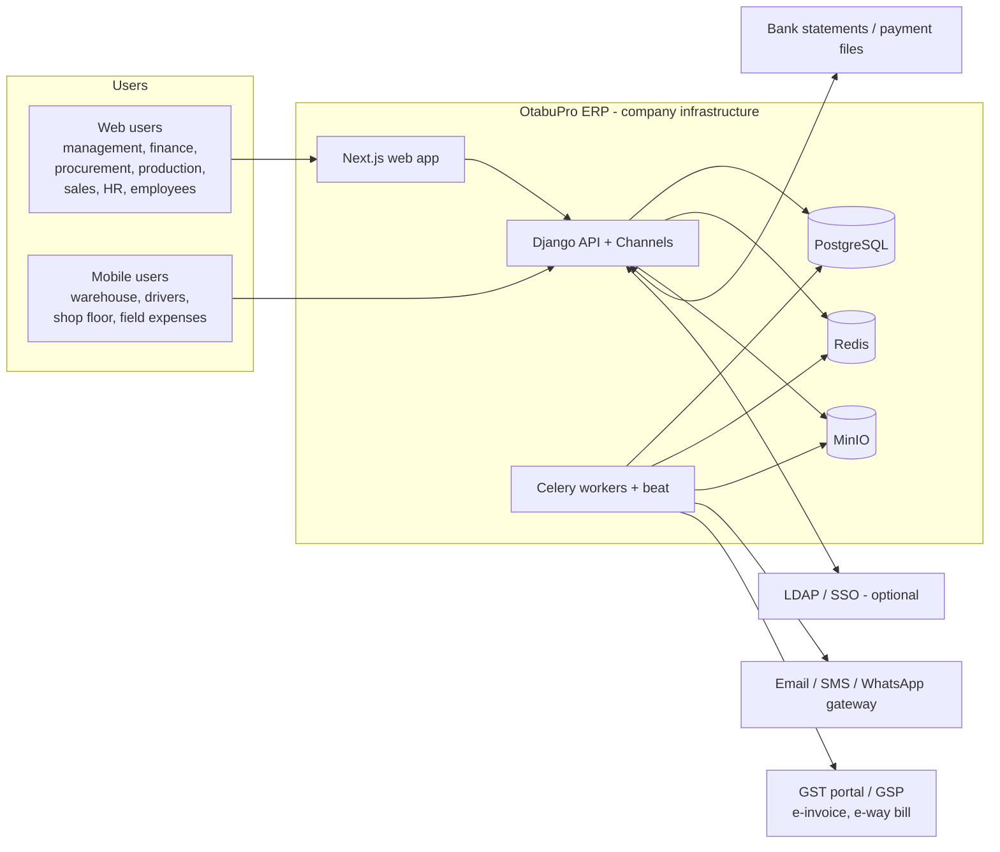
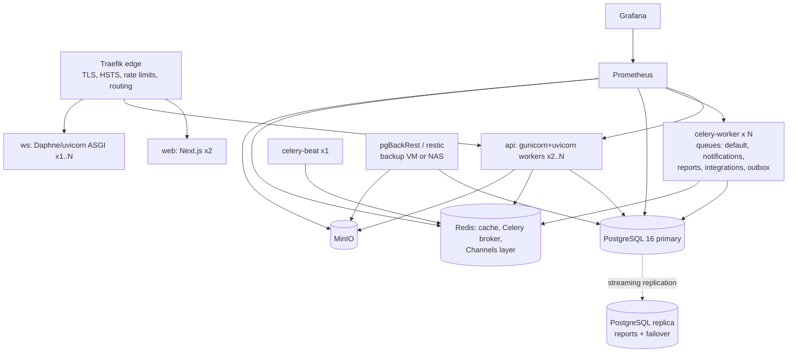
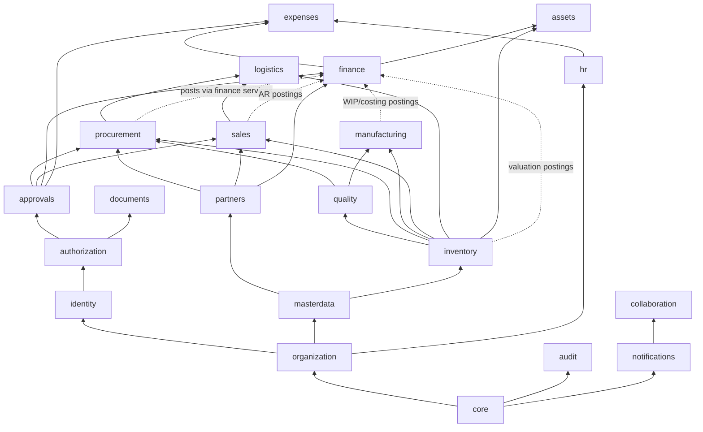

# OtabuPro ERP — Architecture

Status: **Baseline v1.0** (Phase 0 blueprint). Owner: platform architecture.
Related: [SRS](SRS.md) · [Database design](DATABASE_DESIGN.md) · [RBAC/ABAC](RBAC_ABAC.md) · [API](API_SPECIFICATION.md) · [Roadmap](DEVELOPMENT_ROADMAP.md) · [Decisions](DECISIONS.md)

---

## 1. Context and quality goals

A self-hosted, fully integrated manufacturing ERP for one business group (one or more legal entities), 100–500 named users across multiple facilities and warehouses, used through a web app, a mobile app (scanning and field work) and integrations.

| Quality attribute | Target | How the architecture meets it |
|---|---|---|
| **Correctness of stock and money** | Zero drift between sub-ledgers and GL | Authoritative append-only ledgers (`stock_ledger`, `journal_lines`); posting happens in one DB transaction; DB-level immutability triggers; reconciliation jobs |
| **Security** | Default deny; no self-approval | Central Policy Decision Point (RBAC + ABAC), scope isolation in every query, maker-checker, MFA, audit hash chain |
| **Auditability** | Every state change traceable to user, request and reason | `audit_events` (append-only, hash-chained), request IDs, document history, reversals instead of edits |
| **Performance** | p95 < 300 ms for reads and < 800 ms for postings at 150 concurrent users | Indexed scoped queries, cursor pagination on ledgers, Redis cache for authorization snapshots, async reports |
| **Availability** | 99.5% during business hours; RPO ≤ 15 min, RTO ≤ 4 h | Stateless app nodes, PostgreSQL WAL archiving and PITR, MinIO replication, documented recovery runbook |
| **Maintainability** | A module can be changed without touching unrelated ones | Modular monolith with enforced boundaries (import-linter), services layer, event outbox |
| **Operability** | Fully observable on-prem | Prometheus metrics, Grafana dashboards, Sentry (self-hosted or SaaS by decision), structured JSON logs |

### Sizing assumptions
- 500 named users, ~150 peak concurrent, ~20 write transactions/s at peak (scanning bursts).
- ~2 M stock-ledger rows/year and ~3 M journal lines/year at full adoption; this fits comfortably in a single PostgreSQL primary. Partitioning by fiscal year is designed in (see DATABASE_DESIGN §9) but enabled only when needed.

---

## 2. System context



---

## 3. Deployment topology (Proxmox)



| Proxmox VM | Containers | Minimum spec (500 users) |
|---|---|---|
| `erp-app-01` (+ `-02` for HA) | traefik, web, api, ws, celery-worker, celery-beat (beat only on 01) | 8 vCPU, 16 GB RAM |
| `erp-db-01` | postgres primary, postgres-exporter | 8 vCPU, 32 GB RAM, NVMe, separate WAL disk |
| `erp-db-02` | postgres replica | same as db-01 |
| `erp-data-01` | redis, minio | 4 vCPU, 8 GB, 1 TB+ |
| `erp-ops-01` | prometheus, grafana, loki (optional), alertmanager, sentry (optional), backup agent | 4 vCPU, 8 GB |

Development and small sites can run everything on one host with `infrastructure/docker-compose.yml`.

---

## 4. Logical architecture: modular monolith

One Django project, one PostgreSQL database, many **bounded-context modules** (Django apps) with strict boundaries. We chose a monolith over microservices because the core invariant — *stock movement and its accounting entry are committed together* — needs ACID transactions across modules, and the team and scale don't justify distributed transactions.

### 4.1 Layering inside every module

```
apps/<module>/
  models.py         persistence only (fields, constraints, indexes); no business workflows
  domain/           pure business rules, value objects, state machines (no Django ORM writes)
  services.py       PUBLIC write API of the module: commands, run inside transactions
  selectors.py      PUBLIC read API: scoped querysets and read models
  policies.py       resource attribute providers + module-specific ABAC conditions
  events.py         domain event definitions published via the outbox
  handlers.py       subscribers to other modules' events (idempotent)
  tasks.py          Celery tasks (non-critical, async only)
  api/              serializers.py, views.py, filters.py, urls.py (thin: validate → call service → serialize)
  migrations/
  tests/
```

**Rules (enforced by review and `import-linter` contracts in CI):**
1. Views never contain business logic and never call `.save()` on domain models; they call `services`.
2. A module may *read* another module's models through FK relations or `selectors`, but may only *change* another module's data by calling that module's `services`.
3. Critical cross-module consistency (stock + GL, GRN + PO receipt quantity) is done by **synchronous service calls inside one `transaction.atomic()`** that the initiating service owns.
4. Non-critical side effects (notifications, search indexing, analytics refresh, emails, webhooks) go through the **transactional outbox** and are processed asynchronously.
5. Every service command receives an explicit `ActorContext` (user, company, request ID, IP, MFA state) and performs its own authorization check in addition to the view-level check (defence in depth).

### 4.2 Module catalogue and dependency map

| # | Module (Django app) | Responsibility | Depends on |
|---|---|---|---|
| F1 | `core` | Base models (UUIDv7, timestamps, actor stamps), money and quantity types, errors, pagination, idempotency, outbox, document numbering, feature flags, request context | — |
| F2 | `organization` | Organization, company (legal entity), branch, department, facility, warehouse scope nodes, fiscal calendar | core |
| F3 | `identity` | Users, auth sessions, MFA, password policy, lockout, devices | core, organization |
| F4 | `authorization` | Permission catalog, roles, scoped assignments, ABAC policies, SoD rules, approval limits, PDP | core, organization, identity |
| F5 | `audit` | Append-only, hash-chained audit events, access logs, audit search | core, identity |
| F6 | `approvals` | Generic approval workflows, approval matrix, maker-checker execution | core, authorization, audit |
| F7 | `notifications` | In-app, email, SMS, push, WebSocket fan-out, escalation timers | core, identity |
| 2 | `masterdata` | Items/materials, UoM and conversions, categories, HSN/SAC, item variants, barcodes, price lists | core, organization |
| 4 | `partners` | Suppliers, customers, contacts, addresses, GSTIN, bank details, credit terms, ratings | core, organization, masterdata |
| 3 | `inventory` | Locations/bins, stock ledger, balances, batches, serials, reservations, transfers, counts, valuation, ageing | masterdata, organization |
| 14 | `quality` | Inspection plans, inspections, NCR, CAPA, quality holds | inventory, masterdata |
| 5 | `procurement` | MRP suggestions, requisitions, RFQ, quotations, comparison, PO, GRN, returns | partners, inventory, quality, approvals |
| 6 | `manufacturing` | BOM (multi-level, versioned), routings, work centres, production plans and orders, issue, consumption, WIP, output, scrap, rework, costing | inventory, masterdata, quality |
| 7 | `sales` | Quotations, sales orders, credit check, reservation, invoices, returns | partners, inventory, approvals |
| 8 | `logistics` | Inbound/outbound shipments, dispatch, vehicles, drivers, trips, proof of delivery | inventory, sales, procurement |
| 9 | `finance` | CoA, GL posting engine, AP, AR, cash, bank, reconciliation, GST, budgets, cost centres, statements | organization, partners, approvals |
| 10 | `expenses` | Expense claims, fuel logs, advances, reimbursements | finance, approvals, hr |
| 11 | `hr` | Employees, attendance, leave, payroll, salary access | organization, finance |
| 12 | `collaboration` | Tasks, assignments, comments, mentions, discussions, escalation | notifications |
| 13 | `documents` | Document store on MinIO, versions, access control, retention | authorization |
| 15 | `assets` | Fixed assets, depreciation, maintenance plans, work orders, spare consumption | inventory, finance |
| 16 | `analytics` | Report engine, dashboards, KPI read models, forecasting | read-only on all |
| 17 | `integrations` | Webhooks, import/export, GST/e-invoice/e-way bill adapters, bank file adapters, API clients | outbox, all public services |



**Finance integration direction.** Operational modules call `finance.services.post_journal(...)` through an **accounting rules (posting profile) layer**: each operational transaction type maps to configurable account determination rules (item category × warehouse × transaction type → GL accounts). No GL account codes are hardcoded.

---

## 5. Core cross-cutting mechanisms

### 5.1 Posting and immutability
- Business documents go through `draft → submitted → approved → posted → (cancelled by reversal)`. Allowed transitions are defined per document type in the domain state machine.
- **Posting** writes to authoritative ledgers: `stock_ledger_entries` (quantity and value) and `journal_entries/journal_lines`. Rows are `INSERT`-only; PostgreSQL triggers reject `UPDATE`/`DELETE` on posted rows (see DATABASE_DESIGN §6).
- Corrections create **reversal** documents (mirror entries linked by `reverses_id`) and new adjustment documents. Nothing is silently edited.
- Balances (`stock_balances`, `gl_account_balances`) are **derived caches** maintained inside the same transaction and rebuildable from the ledger at any time; nightly reconciliation compares them.

### 5.2 Concurrency control
- Stock postings lock the affected `stock_balances` rows (`SELECT … FOR UPDATE`) in a deterministic order (item_id, warehouse_id, location_id, batch_id) to avoid deadlocks; negative-stock checks happen under that lock.
- Documents carry an integer `version`; updates require `If-Match`/`version` (optimistic locking) → `409 Conflict` on mismatch.
- Document numbers come from `document_sequences` rows locked per (company, series, fiscal year), giving gapless numbers within committed transactions (required for GST invoices).

### 5.3 Idempotency
Every `POST` that creates or posts a business transaction accepts an `Idempotency-Key` header (required for posting endpoints and all mobile writes). The key, the request fingerprint (SHA-256 of method, path and body) and the response are stored in `idempotency_keys` for 24 h (configurable). A replay with the same fingerprint returns the stored response; a different fingerprint returns `422 idempotency_key_reused`. Concurrent duplicates are serialized by a unique constraint and an in-progress state.

### 5.4 Transactional outbox and events
- Services append `outbox_events` rows in the same transaction as the business change (`event_type`, `aggregate_type`, `aggregate_id`, `payload`, `company_id`, `occurred_at`).
- A relay (Celery `outbox` queue, triggered by beat every few seconds and `transaction.on_commit` nudges) claims batches with `SELECT … FOR UPDATE SKIP LOCKED`, dispatches to registered handlers and marks them published; failures back off exponentially and dead-letter after N attempts (visible in admin).
- Handlers are idempotent and record processed `(handler, event_id)` in `inbox_receipts`.
- **Critical stock and accounting updates never depend on the outbox.** It is only for side effects.

### 5.5 Request context and tracing
Middleware assigns `X-Request-ID` (or accepts a trusted one from Traefik), binds it to logs, Sentry, audit events and outbox events. `ActorContext` carries user, active company, scope selection, IP, user-agent, MFA level and request ID into services.

### 5.6 Authorization
Central Policy Decision Point (`authorization.pdp.authorize(subject, action, resource, environment)`), **default deny**, deny-overrides combination of RBAC grants (scoped role assignments) and ABAC policies. DRF permission classes and `selectors.scoped(queryset, actor, action)` both delegate to it. Details: [RBAC_ABAC.md](RBAC_ABAC.md).

### 5.7 Authentication and sessions
- Server-side **opaque session tokens** (256-bit random, stored as SHA-256 hash in `auth_sessions`), with idle timeout (default 30 min) and absolute lifetime (default 12 h), both configurable per role. We deliberately avoid long-lived JWTs so sessions are revocable immediately.
- Web: token in an `HttpOnly; Secure; SameSite=Lax` cookie plus a CSRF double-submit token for unsafe methods. Mobile: `Authorization: Bearer <token>`, device-bound, with refresh by re-authentication or device PIN (Phase 10).
- MFA: TOTP (RFC 6238) with encrypted secrets, hashed recovery codes, step-up MFA for sensitive actions (approvals above a threshold, payroll access, permission changes). WebAuthn is planned.
- Lockout after N failed attempts (configurable), password policy (length ≥ 12, breached-password check against a local list), login and audit events.

### 5.8 Files and documents
MinIO (S3 API) with private buckets. The API checks authorization and returns a short-lived presigned URL (≤ 5 min) for download or upload; uploads are checked for virus (ClamAV, optional) and MIME type, and versioned via `document_versions`.

### 5.9 Real-time
Django Channels with the Redis channel layer. WebSocket connections authenticate with the session cookie or token. Groups: `user.<id>`, `company.<id>.dashboard`, `doc.<type>.<id>`. Used for notifications, approval-queue counts, live dashboards and scan feedback. Messages contain IDs and summaries only; clients fetch details via the authorized REST API.

### 5.10 Background work (Celery)
Queues: `default`, `notifications`, `reports`, `integrations`, `outbox`, `scheduled`. Used for notifications, report generation (to MinIO), MRP runs (results are *suggestions* committed by users), escalations, reconciliation checks, depreciation proposals and imports. Tasks are idempotent, carry the request ID and run under an explicit service account `ActorContext`.

### 5.11 Configuration, not code
Approval thresholds, roles, permissions, taxes (GST rates, HSN mapping), posting profiles, number series, warehouse permissions, negative-stock policy, valuation method and session timeouts are **data**, managed through admin APIs with audit, and seeded by clearly labelled fixtures.

### 5.12 Feature flags
`feature_flags` table (key, enabled, company/role/user targeting, description). Unfinished modules are behind flags and return `404 feature_disabled` from the API and are hidden from navigation. Flags are read through a cached service.

---

## 6. Frontend architecture (Next.js)

- Next.js App Router, TypeScript strict, Tailwind CSS with design tokens (CSS variables) and shadcn/ui primitives, TanStack Query for server state, TanStack Table for data grids, React Hook Form + Zod for forms, Recharts for charts.
- **API client generated from OpenAPI** (`openapi-typescript`), so frontend types match the backend schema.
- Route groups per experience: `(management)`, `(finance)`, `(procurement)`, `(production)`, `(warehouse)`, `(sales)`, `(hr)`, `(self-service)`, sharing one app shell. Navigation is built from `/api/v1/auth/me/` (effective permissions and feature flags). Hiding is cosmetic; the backend enforces every decision.
- Shell: responsive sidebar (collapsible, mobile drawer), command palette and global search (`⌘K`), contextual breadcrumbs, company and branch scope switcher, notification centre (WebSocket), approval inbox badge.
- Patterns: list page (filters in URL, saved views, column chooser, export by permission) → record page (header with status, actions by permission, tabs, activity timeline, attachments, comments) → forms (draft autosave, server validation mapping).
- Accessibility: WCAG 2.1 AA, keyboard-first data entry, visible focus, reduced motion.

## 7. Mobile architecture (Expo)
React Native with Expo, the same OpenAPI client and design tokens. Offline-tolerant scanning queue: operations are stored locally with idempotency keys and replayed; the server stays authoritative and returns conflicts explicitly. Features: GRN receiving, putaway, picking, transfers, cycle counts, material issue, production output, delivery with POD (photo and signature), expense capture with receipt photo, approvals and notifications.

---

## 8. Security architecture summary
- TLS everywhere (Traefik, internal CA for service traffic on multi-host), HSTS, secure headers (CSP, frame-ancestors none, referrer policy).
- Secrets via environment and Docker secrets; field-level encryption (Fernet/AES-GCM) for MFA secrets, bank account numbers, PAN and salary-sensitive fields where specified.
- Rate limiting at Traefik and in DRF throttles (login, MFA, password reset).
- Server-side authorization on every endpoint, object and field (salary fields require `hr.salary.read` plus scope).
- Audit of authentication, authorization denials on sensitive resources, permission changes, data exports and downloads.
- Dependency scanning (pip-audit, pnpm audit), SAST (bandit, semgrep), container scanning (trivy) in CI.
- OWASP ASVS L2 as the verification target.

## 9. Observability
- `/metrics` (django-prometheus; restricted to the internal network), Celery and Postgres exporters, MinIO metrics.
- Grafana dashboards: API latency and error rate, posting throughput, outbox lag, Celery queue depth, DB connections, slow queries, auth failures.
- Alerts: outbox lag > 5 min, failed postings, ledger/balance reconciliation mismatch, backup failure, disk > 80%, error-rate spike.
- Logs: JSON to stdout → Loki or journald; contain request ID, user ID and company ID, never secrets or salary values.

## 10. Backup and recovery
- PostgreSQL: pgBackRest full weekly, differential daily, continuous WAL archive → PITR (RPO ≤ 15 min). Restore test monthly to a scratch VM (scripted).
- MinIO: bucket versioning plus nightly `mc mirror` to backup storage; object lock for audit exports.
- Configuration: infrastructure repo and encrypted `.env` backups.
- Runbooks in `infrastructure/runbooks/`: restore DB to point in time, rebuild app host, rotate secrets, fail over to the replica.

## 11. Testing strategy
| Level | Tooling | Scope |
|---|---|---|
| Unit | pytest | domain rules, PDP, state machines, valuation math |
| Integration | pytest-django + real PostgreSQL | services, transactions, triggers, constraints, API contracts |
| Workflow E2E (API) | pytest scenario suites | P2P, Plan-to-Produce, O2C, Expense-to-Payment with ledger and GL assertions |
| UI E2E | Playwright | critical user journeys per experience |
| Security | authorization matrix tests (every endpoint × role × scope), ZAP baseline | default deny, isolation |
| Performance | Locust | 150 concurrent users, scanning bursts |

## 12. Architecture decision records (summary)
| ADR | Decision |
|---|---|
| 001 | Modular monolith on a single PostgreSQL database |
| 002 | UUIDv7 primary keys (time-ordered for index locality), generated in the application |
| 003 | Append-only ledgers with DB-enforced immutability; corrections by reversal |
| 004 | Opaque server-side sessions instead of JWT |
| 005 | Central PDP with RBAC + ABAC, default deny, deny-overrides |
| 006 | Transactional outbox for side effects; synchronous in-transaction calls for critical consistency |
| 007 | Moving weighted average valuation by default, per company × item × warehouse (configurable; see DECISIONS) |
| 008 | Django 5.2 LTS, PostgreSQL 16 in production (local development verified on 14+) |
| 009 | Money `NUMERIC(20,4)`, quantity `NUMERIC(20,6)`, rate/price `NUMERIC(20,6)`, FX `NUMERIC(18,8)` |
| 010 | Gapless document numbering via locked sequence rows per company, series and fiscal year |
