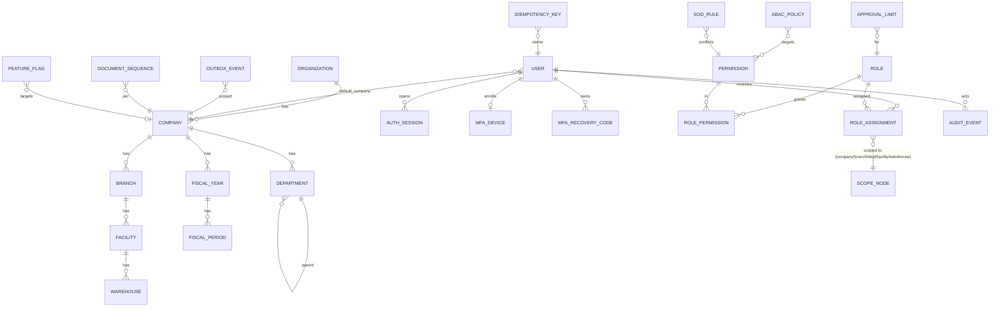
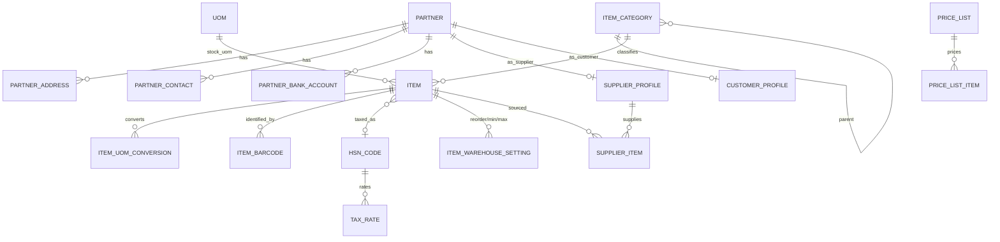
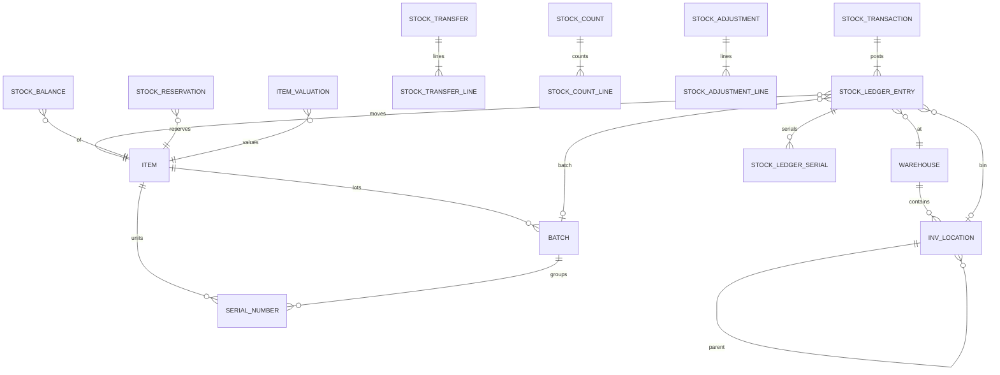
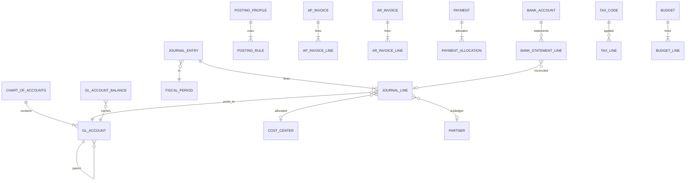

# OtabuPro ERP — Database Design

Status: **Baseline v1.0**. Engine: PostgreSQL 16 (production), 14+ supported for development.
Tables marked **[P1]** are implemented in Phase 1; the others are designed and will be implemented in their phase (see [Roadmap](DEVELOPMENT_ROADMAP.md)).

---

## 1. Conventions

| Topic | Rule |
|---|---|
| Primary keys | `id UUID` (UUIDv7, generated by the application, time-ordered) |
| Naming | `snake_case`, plural table names prefixed by module only where ambiguous (e.g. `inv_locations`) — Django `db_table` set explicitly |
| Scope | Every business row has `company_id` (legal entity). Rows tied to a site also carry `branch_id`/`facility_id`/`warehouse_id`. Master data that is shared group-wide carries `organization_id` |
| Timestamps | `created_at`, `updated_at` (`timestamptz`, UTC); `created_by_id`, `updated_by_id` (FK users, nullable for system) |
| Optimistic lock | `version INTEGER NOT NULL DEFAULT 1` on mutable documents |
| Soft delete | Master data uses `is_active` (deactivate, never delete if referenced). Transactions are never deleted |
| Money | `NUMERIC(20,4)`; currency `CHAR(3)`; documents store both transaction currency and company base currency amounts |
| Quantity | `NUMERIC(20,6)` with `uom_id`; ledger stores quantity in the item's **stock UoM** |
| Rates and prices | `NUMERIC(20,6)`; FX `NUMERIC(18,8)`; percentages `NUMERIC(9,4)` |
| Status | `VARCHAR(20)` with a `CHECK` constraint listing allowed values |
| Posted records | `posted_at`, `posted_by_id`, `is_reversal`, `reverses_id`; immutable once posted (trigger) |
| Foreign keys | Always declared; `ON DELETE PROTECT/RESTRICT` for transactional references |
| Indexes | Every FK; composite indexes led by `company_id` for scoped lists; partial indexes for open documents |
| JSON | `JSONB` only for genuinely schemaless data (policy conditions, event payloads, custom fields) |

Abstract Django bases: `UUIDModel` → `TimeStampedModel` → `ActorStampedModel` → `CompanyScopedModel` (+ `VersionedModel`, `PostableMixin`).

---

## 2. Foundation ERD (Phase 1)



### 2.1 Organization [P1]
| Table | Key columns | Constraints |
|---|---|---|
| `organizations` | id, code, name, base_currency, timezone, is_active | `code` unique |
| `companies` | id, organization_id, code, legal_name, trade_name, gstin, pan, cin, base_currency, fiscal_year_start_month, address JSONB, is_active | unique(organization_id, code); GSTIN format check (15 chars) when present |
| `branches` | id, company_id, code, name, gstin, state_code, address, is_active | unique(company_id, code) |
| `departments` | id, company_id, parent_id, code, name, cost_center_id (Phase 9), head_user_id | unique(company_id, code); no self-parent |
| `facilities` | id, company_id, branch_id, code, name, facility_type (`plant`,`warehouse_site`,`office`,`yard`), address | unique(company_id, code) |
| `warehouses` | id, company_id, branch_id, facility_id, code, name, warehouse_type (`raw_material`,`wip`,`finished_goods`,`quarantine`,`scrap`,`transit`,`general`), allow_negative_stock bool default false, is_active | unique(company_id, code) |
| `fiscal_years` | id, company_id, code (`FY2026-27`), start_date, end_date, status (`open`,`closing`,`closed`) | no overlap per company (exclusion constraint) |
| `fiscal_periods` | id, fiscal_year_id, period_no, start_date, end_date, status (`open`,`soft_closed`,`closed`) — per-module locks for inventory, AP, AR and GL | unique(fiscal_year_id, period_no) |

### 2.2 Identity [P1]
| Table | Key columns | Notes |
|---|---|---|
| `users` | id, email (citext-like, unique lower), full_name, phone, employee_id (Phase 10), default_company_id, is_active, is_staff, is_superuser (break-glass only), password (Argon2id), password_changed_at, failed_login_count, locked_until, mfa_enforced, last_login_at | `is_superuser` cannot be granted through the API |
| `auth_sessions` | id, user_id, token_hash (SHA-256, unique), client_type (`web`,`mobile`,`api`), ip, user_agent, device_id, created_at, last_seen_at, idle_expires_at, absolute_expires_at, mfa_verified_at, revoked_at, revoked_reason | index(user_id, revoked_at) |
| `auth_challenges` | id, user_id, challenge_hash, purpose (`mfa_login`,`step_up`), expires_at, attempts, consumed_at | short-lived MFA login challenge |
| `mfa_devices` | id, user_id (unique, one TOTP per user in v1), secret_encrypted, confirmed_at, last_used_step | `last_used_step` prevents TOTP replay |
| `mfa_recovery_codes` | id, user_id, code_hash, used_at | 10 codes per generation |
| `password_history` | id, user_id, password_hash, created_at | blocks reuse of last N |

### 2.3 Authorization [P1]
| Table | Key columns | Notes |
|---|---|---|
| `permissions` | id, code (`inventory.stock_adjustment.approve`), module, resource, action, description, is_sensitive, requires_mfa | unique(code); action ∈ {create, read, update, delete, approve, reject, export, download, assign, manage, post, cancel} |
| `roles` | id, organization_id, code, name, description, is_system_template, is_active, max_session_minutes | unique(organization_id, code) |
| `role_permissions` | role_id, permission_id, (optional) field_mask JSONB | unique(role_id, permission_id) |
| `role_assignments` | id, user_id, role_id, scope_type (`organization`,`company`,`branch`,`department`,`facility`,`warehouse`), scope_id UUID, include_descendants bool, valid_from, valid_until, granted_by_id, reason | index(user_id); check scope_type list |
| `abac_policies` | id, organization_id, code, description, effect (`allow`,`deny`), priority, actions TEXT[] (permission codes or wildcards), resource_types TEXT[], condition JSONB (expression tree), is_active, version | evaluated by the PDP |
| `sod_rules` | id, organization_id, code, description, permission_a_id, permission_b_id, mode (`same_user_same_record`,`same_user_any`), is_active | `same_user_same_record` = maker cannot be checker |
| `approval_limits` | id, organization_id, company_id (nullable = all), role_id, document_type, currency, max_amount, is_active | used by approvals and PDP environment |

### 2.4 Audit [P1]
| Table | Key columns | Notes |
|---|---|---|
| `audit_events` | id, occurred_at, organization_id, company_id, actor_id, actor_type (`user`,`system`,`service`), action (`auth.login.success`, `inventory.adjustment.posted`, …), resource_type, resource_id, summary, changes JSONB (before/after of changed fields, sensitive fields masked), request_id, ip, user_agent, outcome (`success`,`denied`,`failure`), prev_hash, hash | **Append-only via trigger**; `hash = sha256(prev_hash ‖ canonical_json(row))`, verified by a scheduled job; index(company_id, occurred_at), index(resource_type, resource_id), index(actor_id, occurred_at) |

### 2.5 Core platform [P1]
| Table | Key columns | Notes |
|---|---|---|
| `idempotency_keys` | id, user_id, key, method, path, request_hash, status (`in_progress`,`completed`), response_status, response_body JSONB, created_at, expires_at | unique(user_id, key) |
| `outbox_events` | id, company_id, event_type, aggregate_type, aggregate_id, payload JSONB, request_id, occurred_at, status (`pending`,`published`,`failed`,`dead`), attempts, next_attempt_at, last_error, published_at | partial index on status in (`pending`,`failed`) ordered by next_attempt_at |
| `inbox_receipts` | id, handler, event_id, processed_at | unique(handler, event_id) |
| `document_sequences` | id, company_id, series_code (`PO`,`GRN`,`SI`…), fiscal_year_id, prefix, padding, next_value | unique(company_id, series_code, fiscal_year_id); row-locked on allocation |
| `feature_flags` | id, key, description, enabled_default, rules JSONB (company/role/user targeting), updated_by_id | unique(key) |

---

## 3. Master data and partners ERD (Phase 2–3)



Key rules
- `items`: code, name, item_type (`raw_material`,`component`,`consumable`,`semi_finished`,`finished_good`,`service`,`spare`,`packaging`), stock_uom, purchase_uom, sales_uom, tracking (`none`,`batch`,`serial`,`batch_and_serial`), shelf_life_days, valuation_method override, is_stocked, is_purchasable, is_saleable, is_manufactured, hsn_id, standard_cost, inspection_required_on_receipt.
- An item's tracking mode and stock UoM become **locked** once a ledger entry exists.
- `partners`: one legal party can be both supplier and customer (single GSTIN, two profiles); AP/AR balances stay separate.

---

## 4. Inventory ERD (Phase 2)



### 4.1 `stock_ledger_entries` (authoritative, append-only)
| Column | Type | Notes |
|---|---|---|
| id | uuid | |
| company_id, warehouse_id, location_id | uuid | location nullable when bins not used |
| item_id, batch_id | uuid | |
| stock_transaction_id | uuid | header grouping one posting |
| source_document_type, source_document_id, source_line_id | varchar, uuid, uuid | GRN line, production issue line, delivery line… |
| movement_type | varchar | `receipt`,`issue`,`transfer_out`,`transfer_in`,`production_issue`,`production_receipt`,`scrap`,`adjustment_in`,`adjustment_out`,`sales_issue`,`sales_return`,`purchase_return`,`count_gain`,`count_loss`,`reservation`(no) |
| stock_status | varchar | `unrestricted`,`quality_hold`,`blocked`,`in_transit` |
| quantity | numeric(20,6) | signed (+in / −out), stock UoM, ≠ 0 |
| unit_cost | numeric(20,6) | valuation rate applied |
| value | numeric(20,4) | signed quantity × cost |
| balance_quantity_after, balance_value_after | numeric | running balance per (item, warehouse) for audit and ageing |
| posting_date | date | accounting date (period lock checked) |
| posted_at, posted_by_id | timestamptz, uuid | |
| is_reversal, reverses_id | bool, uuid | |
| journal_entry_id | uuid | GL link (set in same transaction) |

Constraints: `CHECK (quantity <> 0)`; immutable trigger; index(company_id, item_id, warehouse_id, posting_date, id); index(source_document_type, source_document_id).

### 4.2 `stock_balances` (derived cache, row-locked)
unique(company_id, item_id, warehouse_id, location_id, batch_id, stock_status) — NULL-safe via `NULLS NOT DISTINCT` (PG15+) or a COALESCE-based unique index on PG14; columns `quantity`, `reserved_quantity`, `value`, `avg_cost`. `CHECK (quantity >= 0)` **unless** the warehouse allows negative stock (enforced in service under lock plus deferred check). `available = quantity − reserved_quantity`.

### 4.3 Valuation
Default **moving weighted average per company × item × warehouse** (`item_valuations`: quantity, value, avg_cost). FIFO layers (`valuation_layers`) are designed as an option per company (see DECISIONS D-01). Issues are valued at the current average; receipts at the landed cost (PO price + allocated landed cost); landed-cost revaluations post `revaluation` entries plus GL.

---

## 5. Procurement, manufacturing, sales, logistics (Phases 3–5)

```mermaid
erDiagram
  PURCHASE_REQUISITION ||--|{ PR_LINE : lines
  RFQ ||--|{ RFQ_LINE : lines
  RFQ ||--o{ RFQ_SUPPLIER : invites
  SUPPLIER_QUOTATION ||--|{ SQ_LINE : lines
  RFQ ||--o{ SUPPLIER_QUOTATION : receives
  PURCHASE_ORDER ||--|{ PO_LINE : lines
  PR_LINE }o--o{ PO_LINE : fulfilled_by
  GOODS_RECEIPT ||--|{ GRN_LINE : lines
  PO_LINE ||--o{ GRN_LINE : received
  GRN_LINE ||--o| QUALITY_INSPECTION : inspected
  PURCHASE_INVOICE ||--|{ PI_LINE : lines
  PI_LINE }o--o| GRN_LINE : matched
  PURCHASE_RETURN ||--|{ PRET_LINE : lines

  BOM ||--|{ BOM_VERSION : versions
  BOM_VERSION ||--|{ BOM_COMPONENT : components
  BOM_COMPONENT }o--o| BOM : "sub-assembly (multi-level)"
  BOM_VERSION ||--o| ROUTING : uses
  ROUTING ||--|{ ROUTING_OPERATION : ops
  ROUTING_OPERATION }o--|| WORK_CENTER : at
  PRODUCTION_PLAN ||--|{ PRODUCTION_PLAN_LINE : plans
  PRODUCTION_ORDER }o--|| BOM_VERSION : frozen_on
  PRODUCTION_ORDER ||--|{ PO_MATERIAL : requires
  PRODUCTION_ORDER ||--|{ PO_OPERATION : operations
  PRODUCTION_ORDER ||--o{ MATERIAL_ISSUE : issues
  PRODUCTION_ORDER ||--o{ PRODUCTION_RECEIPT : outputs
  PRODUCTION_ORDER ||--o{ SCRAP_RECORD : scraps
  PRODUCTION_ORDER ||--o{ REWORK_ORDER : reworks

  SALES_QUOTATION ||--|{ SQT_LINE : lines
  SALES_ORDER ||--|{ SO_LINE : lines
  SO_LINE ||--o{ STOCK_RESERVATION : reserves
  DELIVERY ||--|{ DELIVERY_LINE : lines
  SO_LINE ||--o{ DELIVERY_LINE : shipped
  SALES_INVOICE ||--|{ SI_LINE : lines
  SALES_RETURN ||--|{ SR_LINE : lines
  SHIPMENT ||--o{ DELIVERY : carries
  SHIPMENT }o--o| VEHICLE : uses
  SHIPMENT }o--o| DRIVER : driven_by
  SHIPMENT ||--o{ PROOF_OF_DELIVERY : evidences
```



Key invariants
- `po_lines.received_quantity`, `invoiced_quantity`, `returned_quantity` are maintained only by GRN/PI/return services inside the posting transaction; `CHECK (received_quantity <= ordered_quantity × (1 + over_receipt_tolerance))`.
- Production orders **freeze** the BOM version and routing at release (`bom_version_id` plus copied `po_materials`). BOM versions are immutable once `approved`; changes create a new version with effective dates.
- WIP is a warehouse of type `wip` per facility plus GL WIP accounts; material issue moves stock RM → WIP; production receipt moves WIP value → FG at actual cost; variances post at order close.
- Sales reservation uses `stock_reservations` (soft, against `available`); delivery consumes the reservation and posts `sales_issue`.

---

## 6. Finance ERD (Phase 5) and posting immutability



### 6.1 `journal_entries` / `journal_lines`
- `journal_entries`: id, company_id, entry_number (gapless), entry_date, fiscal_period_id, source_module, source_document_type, source_document_id, narration, status (`draft`,`posted`), posted_at, posted_by_id, approved_by_id, is_reversal, reverses_id, reversed_by_id, currency, fx_rate.
- `journal_lines`: id, journal_entry_id, line_no, account_id, debit NUMERIC(20,4) ≥ 0, credit NUMERIC(20,4) ≥ 0, `CHECK ((debit = 0) <> (credit = 0))`, base_debit, base_credit, cost_center_id, partner_id, item_id, warehouse_id, tax_code_id, description.
- **Balanced entry**: a `CONSTRAINT TRIGGER … DEFERRABLE INITIALLY DEFERRED` verifies `SUM(base_debit) = SUM(base_credit)` per entry at commit.
- **Immutability**: posted entries and their lines reject `UPDATE`/`DELETE` (trigger raises `posted_record_immutable`). The only permitted update on a posted entry is setting `reversed_by_id` once (whitelisted columns).
- Period lock: posting into a `closed` period is rejected by service and by trigger.

### 6.2 Generic immutability trigger (Phase 1 utility)
```sql
CREATE FUNCTION erp_forbid_mutation() RETURNS trigger AS $$
BEGIN
  RAISE EXCEPTION 'immutable_record: % on % is not allowed', TG_OP, TG_TABLE_NAME
    USING ERRCODE = 'P0001';
END $$ LANGUAGE plpgsql;
-- append-only tables: audit_events, stock_ledger_entries, journal_lines
CREATE TRIGGER audit_events_immutable BEFORE UPDATE OR DELETE ON audit_events
  FOR EACH ROW EXECUTE FUNCTION erp_forbid_mutation();
```
For tables that are mutable while draft but frozen when posted, `erp_forbid_posted_mutation(status_column, allowed_columns[])` is used.

---

## 7. HR, expenses, collaboration, documents, quality, assets (Phases 6–9)

```mermaid
erDiagram
  EMPLOYEE }o--o| USER : linked
  EMPLOYEE }o--|| DEPARTMENT : in
  EMPLOYEE ||--o{ ATTENDANCE_RECORD : attends
  EMPLOYEE ||--o{ LEAVE_REQUEST : requests
  LEAVE_TYPE ||--o{ LEAVE_BALANCE : balances
  SALARY_STRUCTURE ||--|{ SALARY_COMPONENT : components
  EMPLOYEE ||--o{ EMPLOYEE_SALARY : "assigned (restricted)"
  PAYROLL_RUN ||--|{ PAYSLIP : produces
  PAYSLIP ||--|{ PAYSLIP_LINE : lines
  EXPENSE_CLAIM ||--|{ EXPENSE_LINE : lines
  EXPENSE_LINE }o--|| EXPENSE_CATEGORY : categorized
  EXPENSE_LINE ||--o{ DOCUMENT : receipts
  FUEL_LOG }o--o| VEHICLE : for
  EMPLOYEE_ADVANCE ||--o{ ADVANCE_SETTLEMENT : settled
  TASK ||--o{ TASK_ASSIGNMENT : assigned
  TASK ||--o{ COMMENT : discussed
  COMMENT ||--o{ MENTION : mentions
  NOTIFICATION }o--|| USER : to
  ESCALATION_RULE ||--o{ ESCALATION_EVENT : fires
  DOCUMENT ||--|{ DOCUMENT_VERSION : versions
  DOCUMENT ||--o{ DOCUMENT_ACL : access
  DOCUMENT ||--o{ DOCUMENT_LINK : "attached to any record"
  INSPECTION_PLAN ||--|{ INSPECTION_PARAMETER : checks
  QUALITY_INSPECTION ||--|{ INSPECTION_RESULT : results
  QUALITY_INSPECTION ||--o{ NCR : raises
  NCR ||--o{ CAPA : actions
  ASSET ||--o{ DEPRECIATION_SCHEDULE : depreciates
  ASSET ||--o{ MAINTENANCE_PLAN : planned
  MAINTENANCE_PLAN ||--o{ MAINTENANCE_WORK_ORDER : generates
  MAINTENANCE_WORK_ORDER ||--o{ SPARE_CONSUMPTION : consumes
```

Sensitive data: `employee_salaries`, `payslips` and `payslip_lines` amounts and `employees.bank_account`, PAN and Aadhaar reference are encrypted at field level, excluded from generic exports, readable only with `hr.salary.read` within scope, and every read is audited.

Comments, attachments and activity use a **generic record reference** `(resource_type, resource_id)` with an authorization check delegated to the owning resource (you can comment only if you can read the record).

---

## 8. Cross-module consistency map

| Business event | Same DB transaction writes |
|---|---|
| GRN posted | grn status → posted; `stock_ledger_entries` (+, status `quality_hold` if inspection required else `unrestricted`); `stock_balances`; `po_lines.received_quantity`; journal Dr Inventory / Cr GR-IR; outbox `procurement.grn.posted` |
| Inspection accepted | ledger transfer `quality_hold → unrestricted` (or `→ blocked`/return); outbox |
| Purchase invoice posted (3-way match) | AP invoice; journal Dr GR-IR, Dr Input GST / Cr Supplier (AP); price variance to PPV account; `po_lines.invoiced_quantity` |
| Payment posted | payment + allocations; journal Dr AP / Cr Bank; AP open-item status |
| Material issue to production | ledger RM → WIP warehouse; journal Dr WIP / Cr RM inventory; `po_materials.issued_quantity` |
| Production receipt | ledger WIP → FG at computed cost; journal Dr FG inventory / Cr WIP |
| Production order close | variance journal; order status closed |
| Delivery posted | ledger `sales_issue`; reservation consumed; journal Dr COGS / Cr FG inventory; `so_lines.delivered_quantity` |
| Sales invoice posted | AR invoice; journal Dr Customer / Cr Revenue, Cr Output GST; gapless invoice number |
| Expense claim paid | payment; journal Dr Expense (cost centre) / Cr Bank or employee advance |
| Payroll posted | journal Dr Salary expense / Cr Salary payable, statutory liabilities |

---

## 9. Scale and partitioning plan
- Up to ~50 M ledger rows, B-tree indexes suffice. Beyond that, `stock_ledger_entries`, `journal_lines` and `audit_events` are range-partitioned by `posting_date`/`occurred_at` (fiscal year). UUIDv7 keys keep inserts index-local.
- Reports run on the streaming replica via a `reports` DB alias.
- Materialized read models (`mv_stock_ageing`, `mv_ar_ageing`, `mv_kpi_daily`) refresh concurrently on a schedule.

## 10. Data retention
- Financial and GST records: at least 8 years (assumption in line with CGST s.36 plus margin; see DECISIONS).
- Audit events: 8 years, exported yearly to WORM storage (MinIO object lock).
- Auth sessions: purged 90 days after expiry; idempotency keys: 24 h; outbox published rows: 30 days.
